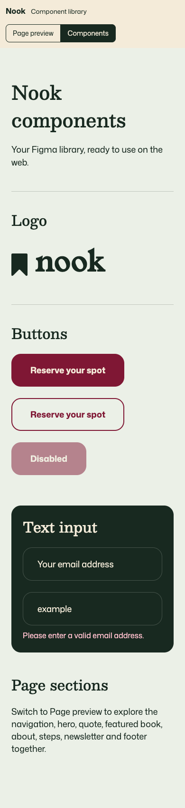

# Nook component library

Reusable React + TypeScript components built from the Nook Figma Library, with plain CSS, original local Figma assets, and local Besley, Mona Sans, and Young Serif fonts.

## Preview

Install Node.js 20.19+ or 22.12+ (Vite 7 requirement), then:

```sh
npm install
npm run dev
```

Open the local address printed in the terminal. The top bar switches between a complete page and primitive component examples.

```sh
npm run build
npm run preview
```

## Components

All eleven components are exported from `src/components/index.ts`. Each component also has its own source file for straightforward Code Connect mapping. Global design tokens and responsive rules live in `src/styles.css`. Include this stylesheet in any consuming application. Keep the public assets directory available at your app base URL; Vite handles fonts as bundled assets.

Button supports primary/secondary variants and native button attributes. TextInput supports native input attributes, an accessible label, and optional error text. Sections expose content options where useful. Navigation has a keyboard-operable mobile menu. SectionNewsletter validates email addresses using native browser validation and accepts an async `onSubscribe(email)` callback, including pending, success, and failure feedback. SectionMonthBook accepts `onReserve`.

## Figma connection

Follow [CONNECT-FIGMA.md](CONNECT-FIGMA.md) for exact source-file mappings. Code Connect connects existing code to Figma; building this repository does not automatically publish those mappings.

## Preview limitations

The newsletter does not save or send email without an `onSubscribe` callback. The reservation button opens an explanatory preview dialog, not a real booking. Preview copy reproduces the supplied design, including its sample date/day text; replace it before a real event. Mobile layouts and focus/disabled/hover states are implementation additions because separate mobile/state designs were not supplied. Preview controls are outside the component library.

## Assets and fonts

Images and bookmark vectors were downloaded from the supplied Figma nodes. Their usage rights remain with their original owners. Font license notices are in `src/fonts/licenses/` (SIL Open Font License). No private API credentials are included.

## Verified

Production build and TypeScript checks pass. Chrome verification covered 1440, 1024, 768, and 390 pixel widths without horizontal overflow, loaded images and fonts, mobile navigation, the reservation dialog, newsletter preview feedback, and the component gallery. No runtime errors were observed.



[Full desktop preview](previews/desktop.png)

## Connected homepage

The default route renders Figma homepage node 8017:4198 using the connected components, including the book-exchange photo above the footer. Append `?library` to the preview URL to show the library toolbar and component examples. The Figma Code Connect lookup confirmed the component source paths. The two nested Button mappings have no component name; set their component name to `Button` in Figma.

## Styleguide

Visit `/styleguide` for all 27 local Figma primitives, 9 text styles, and 11 live components. Search components, edit typography samples, copy colors, and expand responsive previews.

## Variable sync

See [VARIABLE-SYNC.md](VARIABLE-SYNC.md) for the no-code export/upload workflow and optional Enterprise API action. Figma exports live in `design/figma-variables.json`. Every production build regenerates CSS and the styleguide inventory from that export. The initial export includes the green highlight `#5d9b31`.

Do not hand-edit generated `src/tokens.css`. Future changes are: edit Figma → export variables → upload the JSON to GitHub → review/merge → Vercel publishes. The read-only local exporter is in `figma-exporter/`.
